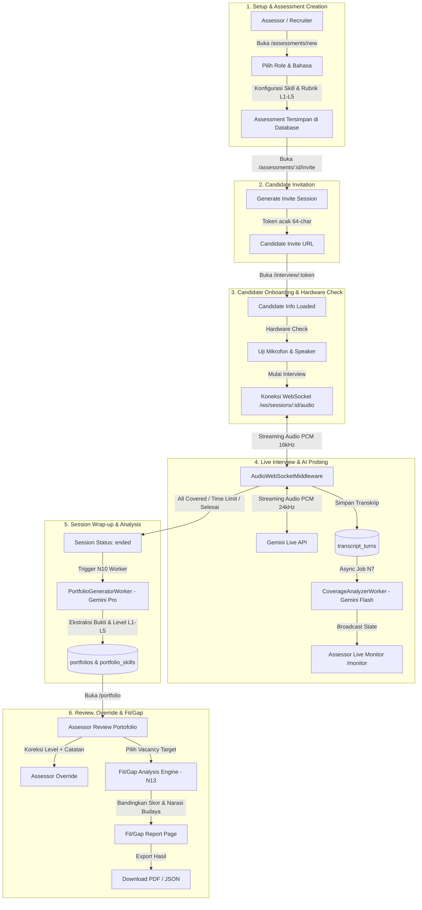

# Product and Domain Immersion
## Case Study: AI Interview Platform (`ai-interview-platform`)

Dokumen ini merupakan hasil penyelaman mendalam terhadap produk, domain hiring & talent assessment di Indonesia, regulasi privasi data (UU PDP), serta pemetaan arsitektur pemrosesan AI.

---

## 1. End-to-End Workflow Map

Alur kerja platform mencakup 6 fase operasional:

---

## 2. Pemetaan Persona Pengguna (User Personas & Pain Points)

### 1. Assessor (Penilai Teknis / Subject Matter Expert)
- **Peran**: Bertanggung jawab menetapkan rubrik kompetensi (L1–L5), memantau wawancara, dan mengevaluasi hasil akhir kandidat.
- **Kebutuhan**:
  - Rubrik kompetensi yang terstandarisasi agar tidak menilai berdasarkan intuisi semata.
  - Bukti kutipan verbatim (*evidence quotes*) dari jawaban kandidat untuk memvalidasi mengapa AI memberikan level tertentu.
  - Kendali penuh untuk melakukan koreksi (*override*) terhadap skor AI apabila penilaian model dirasa terlalu lunak atau bias.
- **Pain Points**:
  - Penilaian AI yang seperti "kotak hitam" tanpa bukti ucapan kandidat.
  - Inkonsistensi data ketika assessor meng-override level namun laporan Fit/Gap tidak diperbarui.

### 2. Recruiter (Talent Acquisition Specialist)
- **Peran**: Mengatur pembukaan lowongan (*vacancies*), mengundang kandidat, dan memantau status penyelesaian wawancara.
- **Kebutuhan**:
  - Kemudahan pembuatan link undangan dan kejelasan status kandidat (*Awaiting candidate*, *Live now*, *Completed*, *Failed*).
  - Integrasi cepat profil kandidat dengan lowongan kerja yang relevan.
- **Pain Points**:
  - Link undangan yang salah port atau mengarah ke endpoint yang tidak ada.
  - Kurangnya visibilitas jika kandidat mengalami kendala teknis saat bergabung.

### 3. Hiring Manager (Kepala Divisi / Pengambil Keputusan Perekrutan)
- **Peran**: Memutuskan apakah kandidat layak dipekerjakan (*hiring decision*).
- **Kebutuhan**:
  - Laporan komparasi ringkas antara kualifikasi kandidat dengan ekspektasi jabatan (*Fit/Gap analysis*).
  - Narasi keselarasan budaya kerja (*culture narrative*) dan indikator risiko kompetensi.
- **Pain Points**:
  - Kesimpulan AI yang ambigu atau tidak dapat dipertanggungjawabkan saat audit hiring.
  - Laporan yang tidak dapat diekspor secara rapi untuk dibagikan ke jajaran pimpinan.

### 4. Kandidat yang Diwawancarai (*The Impacted Party*)
- **Peran**: Pihak terdampak langsung yang mengikuti wawancara berbasis suara dengan AI.
- **Kebutuhan**:
  - Pengalaman wawancara yang adil, tidak mengintimidasi, dan transparan.
  - Kejelasan apakah mikrofon dan audio berfungsi sebelum sesi dimulai (*Hardware check*).
  - Feedback yang jelas jika terjadi kegagalan jaringan atau sesi terputus.
- **Pain Points**:
  - *Silent failure*: error teknis yang justru menampilkan status seolah-olah wawancara sudah selesai padahal sesi belum berjalan.
  - Kekhawatiran mengenai privasi rekaman suara dan penggunaan data mereka oleh model AI.

---

## 3. Konteks Hiring Indonesia & Implikasi Regulasi (UU PDP)

### A. Karakteristik Talent Assessment di Indonesia
1. **Pola Komunikasi Campuran (Bilingual ID-EN)**: Kandidat tech di Indonesia sering menggunakan istilah teknis bahasa Inggris bercampur bahasa Indonesia (code-switching). Model AI harus mampu menangkap makna kontekstual tanpa menilai rendah kandidat hanya karena aksen atau gaya bahasa.
2. **Kecenderungan Subjektivitas ("Culture Fit" vs "Competency")**: Banyak proses seleksi lokal terjebak pada bias subjektif pewawancara. Standardisasi rubrik L1–L5 dengan indikator perilaku terukur (*behavioral anchors*) membantu perusahaan mengambil keputusan berbasis bukti nyata.
3. **Keterbatasan Infrastruktur Jaringan**: Koneksi internet kandidat bervariasi. Mekanisme rekoneksi audio WebSocket dan toleransi latency sangat krusial agar kandidat di luar kota besar tidak dirugikan.

### B. Kepatuhan UU No. 27 Tahun 2022 tentang Perlindungan Data Pribadi (UU PDP)
Platform ini memproses data yang memiliki implikasi hukum serius:
1. **Kategori Data Pribadi**:
   - **Data Pribadi Umum**: Nama lengkap kandidat, email, riwayat pekerjaan, dan ID sesi.
   - **Data Pribadi Spesifik**: Rekaman suara (audio biometrik), transkrip verbatim percakapan, serta profil penilaian kapasitas intelektual dan kompetensi kerja (Pasal 4 UU PDP).
2. **Kewajiban Pengendali Data (Pasal 20–39 UU PDP)**:
   - **Dasar Pemrosesan yang Sah (Consent)**: Sebelum mikrofon diaktifkan, kandidat harus diberi tahu secara eksplisit bahwa audio mereka akan direkam, ditranskripsikan, dan dianalisis oleh AI untuk keperluan seleksi kerja.
   - **Pembatasan Tujuan (*Purpose Limitation*)**: Data percakapan hanya boleh digunakan untuk evaluasi lowongan terkait dan tidak boleh digunakan untuk melatih model AI publik tanpa persetujuan terpisah.
   - **Integritas & Keamanan**: Token undangan publik (`invite_token`) harus berentropi tinggi, memiliki batas kedaluwarsa, dan payload log backend tidak boleh membocorkan data pribadi kandidat (*data sanitization*).
   - **Hak Subjek Data**: Kandidat berhak mengetahui hasil penilaian dan meminta penghapusan rekaman data audio setelah periode rekrutmen selesai.

---

## 4. Pemetaan Data Sensitif & Titik Pemrosesan AI dalam Sistem

| Titik Pemrosesan | Model / Komponen | Input Data | Output Data | Tingkat Sensitivitas |
|---|---|---|---|---|
| **Audio Ingestion** | `AudioWebSocketMiddleware` | Raw PCM audio stream 16kHz dari kandidat | Buffer audio + streaming ke Gemini | **Sangat Tinggi** (Audio biometrik kandidat) |
| **Conversational AI** | Gemini Live Preview | System prompt asesor + audio kandidat | Respon suara AI + audio transkripsi | **Sangat Tinggi** (Dialog langsung kandidat) |
| **Transkripsi Database** | Tabel `transcript_turns` | Teks hasil ASR Gemini per giliran | Transkrip percakapan tersimpan permanen | **Tinggi** (Pernyataan & klaim kandidat) |
| **Coverage Tracking** | `CoverageAnalyzerWorker` (Gemini Flash) | Transkrip percakapan + daftar skill yang diuji | Status state: `not_yet`, `initiated`, `partial`, `covered` | **Sedang** (Data analitik wawancara) |
| **Portfolio Generation** | `PortfolioGeneratorWorker` (Gemini Pro) | Transkrip lengkap + anchor rubrik L1-L5 | Skor level 1–5, tingkat keyakinan, bukti kutipan, ringkasan | **Tinggi** (Profil evaluasi karir kandidat) |
| **Assessor Override** | `PortfolioSkillsController` | Input manusia (level baru + catatan assessor) | Rekor `assessor_overrides` | **Tinggi** (Keputusan final asesor) |
| **Fit/Gap Evaluation** | `FitGapGeneratorWorker` (Gemini Flash) | Profil skill kandidat + kriteria lowongan | Komparasi numerik + narasi kecocokan budaya | **Tinggi** (Rekomendasi penerimaan kerja) |

---

## 5. Pertanyaan Terbuka & Anomali Kritis yang Teridentifikasi

1. **Bug Rute URL Undangan Kandidat (`session.invite_url`)**:
   - `api/app/models/session.rb:29` menggunakan `APP_BASE_URL` yang diset ke `http://localhost:3001`.
   - Akibatnya link yang di-generate adalah `http://localhost:3001/interview/:token`. Padahal rute ini berada di frontend React pada port 5173. Kandidat yang mengklik link tersebut akan mendapatkan 404 Routing Error dari Rails.
2. **Silent Failure & Defective State pada Rute Kandidat (`InterviewPage.tsx:51`)**:
   - Kegagalan API/koneksi saat kandidat membuka link ditangkap oleh `.catch(() => setInterviewState("complete"))`.
   - Kandidat yang gagal memuat info sesi justru melihat pesan sukses *"Interview Complete"*. Ini melanggar prinsip keadilan dan transparansi kegagalan.
3. **Ketiadaan Consent & Privacy Notice Banner**:
   - Halaman onboarding kandidat belum menyertakan pemberitahuan persetujuan pemrosesan data pribadi (sesuai UU PDP) sebelum mengizinkan kandidat memulai sesi rekaman suara.
